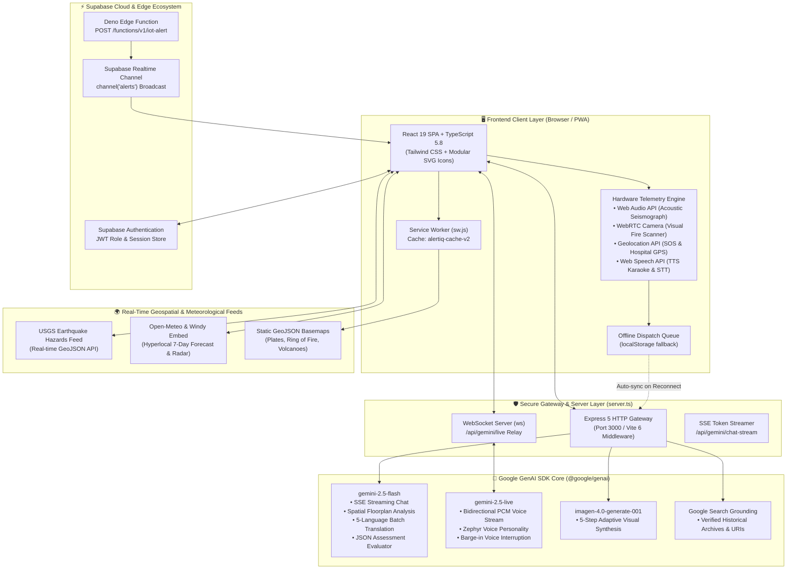
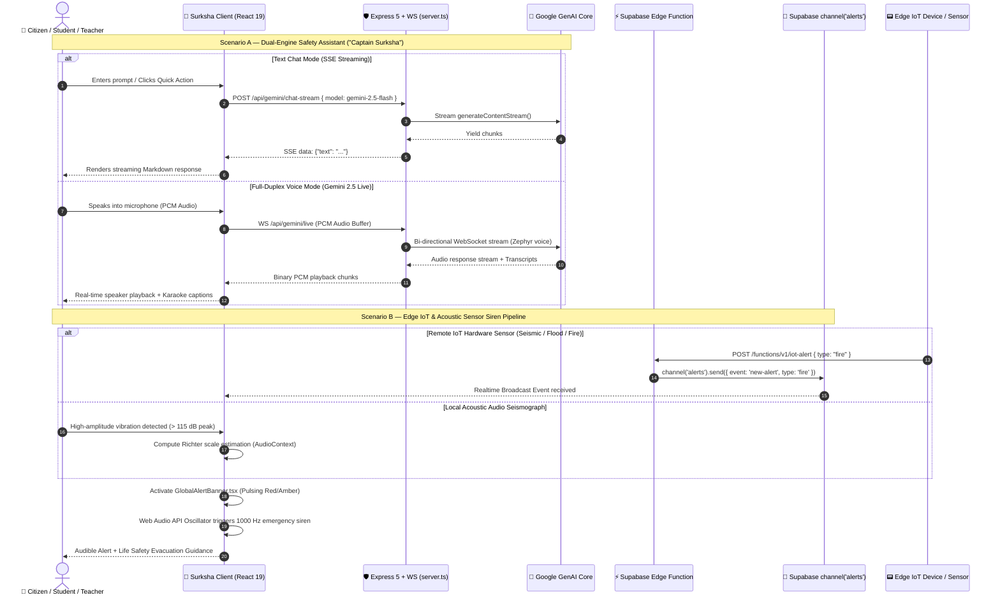

<div align="center">


# 🛡️ Surksha: AlertIQ Platform
### *Enterprise Disaster Management, Education & Real-Time Crisis Telemetry*

**🇮🇳 Sikshit Bharat, Surakshit Bharat — Educated India, Safe India**

[](https://react.dev/)
[](https://www.typescriptlang.org/)
[](https://tailwindcss.com/)
[](https://vitejs.dev/)
[](https://expressjs.com/)
[](https://github.com/websockets/ws)
[](https://ai.google.dev/)
[](https://ai.google.dev/)
[](https://ai.google.dev/)
[](https://ai.google.dev/)
[](https://supabase.com/)
[](https://leafletjs.com/)
[](https://developer.mozilla.org/)
[](https://developer.mozilla.org/en-US/docs/Web/Progressive_web_apps)
[](LICENSE)

*An enterprise-grade, mission-critical crisis-preparedness ecosystem aligning institutional education with real-time IoT hardware telemetry, multimodal spatial floorplan pathfinding, zero-exposure server-side Gemini intelligence, and offline-first life safety infrastructure for India and the world.*

---

### 🌐 Quick Navigation Index
- [🌟 Executive Vision, National Mission & Engineering Significance](#-executive-vision-national-mission--engineering-significance)
- [🏗️ End-to-End System Architecture & Mermaid Diagrams](#️-end-to-end-system-architecture--mermaid-diagrams)
- [🛠️ Comprehensive Technology Stack](#️-comprehensive-technology-stack)
- [🚀 Deep-Dive into the 11 Core Functional Pillars](#-deep-dive-into-the-11-core-functional-pillars)
  - [1. Interactive Curriculum, Quizzes & Adaptive Visual Simulations](#pillar-1-interactive-disaster-curriculum-mastery-quizzes--adaptive-visual-simulations)
  - [2. Crisis Response & Offline-First Emergency Automation](#pillar-2-crisis-response--offline-first-emergency-automation)
  - [3. Digital Hardware Sensors & IoT Simulation](#pillar-3-digital-hardware-sensors--iot-simulation)
  - [4. Meteorological & Geospatial Intelligence](#pillar-4-meteorological--geospatial-intelligence)
  - [5. AI Multimodal Spatial Exit Planner](#pillar-5-ai-multimodal-spatial-exit-planner)
  - [6. AI Study & Preparedness Notebook](#pillar-6-ai-study--preparedness-notebook)
  - [7. Collaborative Communication Hub](#pillar-7-collaborative-communication-hub)
  - [8. "Captain Surksha" Dual-Engine AI Companion](#pillar-8-captain-surksha-dual-engine-ai-companion)
  - [9. Government & Administrative Disaster Console](#pillar-9-government--administrative-disaster-console)
  - [10. 7-Role RBAC & Institutional Progress Analytics](#pillar-10-7-role-rbac--institutional-progress-analytics)
  - [11. Multilingual Localization & Assistive Accessibility](#pillar-11-multilingual-localization--assistive-accessibility)
- [📡 Backend API, WebSocket & Edge Function Reference](#-backend-api-websocket--edge-function-reference)
- [📂 Complete Annotated Project Directory Structure](#-complete-annotated-project-directory-structure)
- [💻 Local Development, Production Build & IoT Webhook Testing](#-local-development-production-build--iot-webhook-testing)
- [👥 Contributing, Ethos & Authors](#-contributing-ethos--authors)

</div>

---

## 🌟 Executive Vision, National Mission & Engineering Significance

Disaster preparedness in densely populated nations faces a fundamental systemic barrier: **the chasm between static textbook safety guidelines and high-stress, real-time crisis execution**. During earthquakes, sudden flash floods, cyclonic landfalls, or urban school fires, panic and communication blackouts frequently paralyze traditional response networks.

**Surksha: AlertIQ Platform** is engineered to bridge this gap. Designed specifically for **K–12 and higher-education students, teachers, school administrators, parents, and government disaster management officials** (aligned with the operational frameworks of the **National Disaster Management Authority - NDMA** and **National Disaster Response Force - NDRF**), Surksha transforms theoretical safety education into active, muscle-memory preparedness backed by live hardware telemetry.

```
       🇮🇳 "Sikshit Bharat, Surakshit Bharat" (Educated India, Safe India)
  ┌─────────────────────────┐          ┌─────────────────────────┐
  │ Institutional Education │  ◄─────► │ Hardware Telemetry & AI │
  │ K-12, Colleges, Faculty │          │ IoT, WebRTC, Seismograph│
  └─────────────────────────┘          └─────────────────────────┘
```

### 💎 Why This Platform Stands Out: 5 Architectural Distinctions

1. **Zero Client-Side API Key Exposure**:
   Unlike prototype web apps that bundle third-party LLM keys inside compiled client JavaScript bundles, Surksha executes the `@google/genai` SDK **strictly server-side** behind a unified **Express 5 + WebSocket (`ws`)** gateway (`server.ts`). The browser frontend communicates via authenticated JSON RPCs, Server-Sent Events (SSE), and secure WebSocket duplex channels—guaranteeing complete cryptographic protection for enterprise credentials.

2. **Sub-Second Multimodal & Full-Duplex Voice AI**:
   - **`gemini-2.5-flash`**: Powers token-streaming emergency consultations, strict JSON structured schema evaluations, 5-step interactive disaster drills, and spatial blueprint computer-vision pathfinding.
   - **`gemini-2.5-live`**: Streams bidirectional raw PCM audio at sub-second latency for the interactive safety avatar **"Captain Surksha"**, utilizing Google's natural **Zephyr** speech model with instant voice barge-in / interruption handling.
   - **`imagen-4.0-generate-001`**: Dynamically generates photorealistic, situational disaster imagery tailored to each step of a student's tactical simulation.
   - **Google Search Grounding**: Augments historical disaster archives with live web grounding, pulling verifiable government facts and exact URI citations.

3. **Browser Hardware Telemetry & Edge IoT Integration**:
   Surksha turns commodity mobile and desktop browsers into edge crisis nodes without requiring proprietary hardware:
   - **Web Audio API (`AudioContext` + `AnalyserNode`)**: Maps acoustic microphone signals to real-time waveform oscillations on an HTML5 Canvas seismograph, triggering threshold-based Richter scale alerts upon detecting physical concussions.
   - **MediaDevices WebRTC API**: Captures live environment frames for computer-vision smoke, flame, and hazard analysis.
   - **Web Audio Oscillators**: Programmatically synthesizes emergency alert tones and pulsing sirens directly inside browser audio hardware.
   - **Supabase Deno Edge Functions**: Ingests external IoT seismic and fire webhooks and broadcasts notifications over `channel('alerts')` with sub-second delivery.

4. **Offline-First Crisis Resilience**:
   In true natural disasters, cellular base stations and terrestrial broadband frequently collapse. Surksha operates on a resilient **Progressive Web App (PWA)** architecture:
   - A custom **Service Worker (`sw.js`, `alertiq-cache-v2`)** caches the complete application shell, UI assets, and global GeoJSON tectonic fault-line datasets.
   - An **Offline Distress Dispatch Queue (`DistressForm.tsx`)** serializes SOS alerts, GPS coordinates, and voice transcripts into persistent `localStorage` during network blackouts. The system listens for the browser's `online` event (`App.tsx`) and automatically flushes the dispatch queue to rescue authorities the instant connectivity is restored.

5. **Inclusive Localization & Assistive Accessibility**:
   Disaster communication must reach every citizen regardless of language or physical ability:
   - **5 Indian Languages**: Intelligent, debounced batch translation powered by Gemini across **English**, **Hindi (हिन्दी)**, **Bengali (বাংলা)**, **Tamil (தமிழ்)**, and **Telugu (తెలుగు)** with in-memory caching.
   - **Karaoke-Style Screen Reader (`TTSContext.tsx`)**: Integrates Web Speech API text-to-speech with live **amber word highlighting** (`.tts-highlight`) across UI text elements, featuring dynamic playback speed (0.5x–2.0x) and pitch modulation.
   - **Hands-Free Voice Dictation (`useSpeechRecognition.ts`)**: Enables zero-touch emergency reporting and chatbot interactions via speech recognition.

---

## 🏗️ End-to-End System Architecture & Mermaid Diagrams

### Diagram 1 — Full-Stack System Topology


---

### Diagram 2 — Dual-Engine AI & IoT Real-Time Alert Pipeline


---

## 🛠️ Comprehensive Technology Stack

| Layer | Technology | Version | Purpose & Architectural Role |
| :--- | :--- | :--- | :--- |
| **Frontend Framework** | `React` | `^19.1.1` | Concurrent rendering, modern hooks, and component lifecycle management. |
| **Language & Typings** | `TypeScript` | `~5.8.2` | Comprehensive type contracts (`types.ts`) guaranteeing end-to-end memory safety. |
| **Styling & Design System** | `Tailwind CSS` | `3.4.1` | Utility-first responsive styling, dark/light theme tokens, and dynamic alert animations. |
| **Build Tooling & Dev** | `Vite` | `^6.2.0` | Ultra-fast HMR, asset bundler, and development server middleware. |
| **Backend Framework** | `Express` | `^5.0.1` | High-throughput HTTP API gateway, SSE stream broker, and static file distributor. |
| **WebSocket Engine** | `ws` | `^8.18.0` | RFC 6455 compliant WebSocket server for sub-second bidirectional voice sessions. |
| **Primary Multimodal AI** | `gemini-2.5-flash` | Latest | High-speed LLM for chat streaming, JSON validations, translations, and CV floorplan analysis. |
| **Live Voice AI Engine** | `gemini-2.5-live` | Latest | Low-latency audio-to-audio conversational intelligence utilizing the **Zephyr** voice model. |
| **Generative Image AI** | `imagen-4.0-generate-001`| Latest | High-fidelity photorealistic synthesis for 5-step visual disaster simulation scenarios. |
| **Fact Grounding** | `Google Search Grounding`| Latest | Live web search grounding with verified source URI extraction for historical disaster news. |
| **Edge Serverless** | `Supabase Edge Functions`| Deno std | Serverless TypeScript endpoint (`/functions/v1/iot-alert`) receiving IoT webhook alerts. |
| **Realtime Pub/Sub** | `Supabase Realtime` | `^2.49.1` | Low-latency WebSocket broadcasting (`channel('alerts')`) to all active browser sessions. |
| **Geospatial GIS** | `Leaflet.js` | `1.9.4` | Interactive CartoDB tile maps, GeoJSON boundary projections, and tectonic monitors. |
| **Hardware Audio API** | `Web Audio API` | Native | `AudioContext`, `AnalyserNode` acoustic seismograph, and `OscillatorNode` sirens. |
| **Hardware Video API** | `MediaDevices WebRTC` | Native | `navigator.mediaDevices.getUserMedia` environment camera capture for fire/smoke scans. |
| **Speech Technologies** | `Web Speech API` | Native | `speechSynthesis` assistive reader and `webkitSpeechRecognition` hands-free STT. |
| **Offline Caching** | `Service Worker Cache API`| Native | `alertiq-cache-v2` offline shell, GeoJSON datasets, and fallback static assets. |

---

## 🚀 Deep-Dive into the 11 Core Functional Pillars

### Pillar 1: Interactive Disaster Curriculum, Mastery Quizzes & Adaptive Visual Simulations
Surksha features an accredited curriculum spanning **7 specialized hazard modules** aligned with NDMA preparedness standards:

| Module ID | Hazard Discipline | Critical Concepts Taught | Region Specifics & Protocols |
| :--- | :--- | :--- | :--- |
| **`mod-1`** | **Earthquake Safety** | P-waves vs. S-waves, Fault Lines, Structural Triangles | *Himalayan Belt & Zone V*: Drop, Cover, and Hold On! |
| **`mod-2`** | **Flood Preparedness** | Flash Floods, Riverine Overflows, Water Contamination | *Coastal & River Basins*: "Turn Around, Don't Drown!" |
| **`mod-3`** | **Fire Safety in Schools** | Fire Triangle (Fuel, Oxygen, Heat), Evacuation Routes | *Urban Campuses*: The **PASS** Extinguisher Method (Pull, Aim, Squeeze, Sweep). |
| **`mod-4`** | **Surviving Cyclones** | Low-Pressure Formation, Calm Eye Trap, Storm Surges | *East/West Coastlines*: Window Boarding & Battery Comms. |
| **`mod-5`** | **Tsunami Awareness** | Undersea Megathrust Earthquakes, Coastal Drawback | *Coastal & Pacific Rim*: Natural warning recognition & high-ground dash. |
| **`mod-6`** | **Severe Thunderstorms** | Lightning Ground Currents, Downbursts, Flash Flooding | *All Subtropical Zones*: The **30/30 Rule** & indoor plumbing safety. |
| **`mod-7`** | **HazMat Incidents** | Industrial Chemical Leaks, Vapor Plumes, Toxicity | *Industrial Corridors*: Upwind evacuation vs. Shelter-in-Place room sealing. |

#### 🎓 Mastery Quizzes & Solutions Review
- Each module is accompanied by an interactive quiz (`Quiz.tsx`) with randomized multiple-choice questions.
- Immediate granular feedback is displayed upon completion (`QuizResult.tsx`), with deep explanations and references accessible via the **Solutions Review Portal** (`SolutionsView.tsx`).

#### 🔬 5-Step Adaptive Visual Simulations (`Simulation.tsx`)
- Leveraging **`gemini-2.5-flash`** for cognitive scenario branching and **`imagen-4.0-generate-001`** for visual rendering, the simulation engine generates a five-phase, high-stakes disaster scenario.
- Steps 1–2 test immediate procedural reflexes via multiple-choice decisions.
- Steps 3–5 require short-form written tactical explanations, graded dynamically out of 10 by Gemini with constructive remedial feedback.

#### 🏅 Gamification Badges & Verifiable Certificates
Students earn gamified accolades stored in their profile (`types.ts`, `StudentProgress`):
- 🛡️ **Rookie Responder**: Awarded upon completing their first module quiz and simulation.
- 🎯 **Quiz Whiz**: Scored 100% on any module quiz.
- ⚗️ **Lab Pro**: Achieved 90%+ in an adaptive scenario simulation.
- 🌍 **Earthquake Expert**: Mastered both theoretical and tactical seismic labs.
- 🏆 **Preparedness Champion**: Accumulated over 1,000 readiness points.
- 📜 **Printable / PDF Certificates (`Certificate.tsx`)**: Generates an official, printable Certificate of Preparedness featuring the emblem of the Government of India, the student's name, school, completion timestamp, and authorization signatures from AlertIQ Platform & NDMA.

---

### Pillar 2: Crisis Response & Offline-First Emergency Automation
In sudden crises, seconds decide outcomes. Surksha equips users with rapid-action interfaces:

- **Floating Universal Panic Button (`PanicButton.tsx`)**: Always visible across all platform screens. Tapping opens the high-contrast **`PanicModal.tsx`**.
- **1-Tap Direct Dispatch**: Instant telephone dial triggers for `112` (National Emergency Hotline) and `108` (Emergency Ambulance Services).
- **Nearest Hospital Routing**: Pulls current device GPS coordinates and opens a radius search on Google Maps for trauma centers and medical facilities.
- **Distress Form & Offline Dispatch Queue (`DistressForm.tsx` & `App.tsx`)**:
  - Auto-captures GPS coordinates with high accuracy (`enableHighAccuracy: true`).
  - Supports hands-free voice transcription for victim reports.
  - **Network Resilience Protocol**: If the user submits while disconnected, the payload is serialized to `localStorage` under `pendingDistressCall`. An active event listener on `window.addEventListener('online')` automatically transmits the cached alert the moment the device reconnects to a tower or network.

---

### Pillar 3: Digital Hardware Sensors & IoT Simulation
Transforming commodity browser runtimes into functional disaster sensor stations (`IoTAlertDashboard.tsx`):

1. **AI Visual Fire & Hazard Scanner**:
   - Streams live camera feeds via `navigator.mediaDevices.getUserMedia({ video: { facingMode: 'environment' } })`.
   - On frame capture, renders to an off-screen HTML5 canvas, encodes as base64 JPEG, and transmits to `gemini-2.5-flash`.
   - Enforces a strict JSON response schema: `{ "is_fire": boolean, "safety_instructions": string }`. If fire or dense smoke is detected, the platform automatically triggers an audio-visual alarm.

2. **Acoustic Audio Seismograph (`SeismographChart.tsx`)**:
   - Attaches an `AudioContext` and `AnalyserNode` to the client's microphone.
   - Extracts real-time time-domain byte data (`getByteTimeDomainData`), mapping amplitude deviations from the zero-point (128) onto a continuous HTML5 Canvas waveform.
   - Concussive audio vibrations exceeding the calibrated `VOLUME_THRESHOLD` (115/128) automatically trigger seismic alert routines, estimating Richter-scale intensity and prompting immediate "Drop, Cover, and Hold On!" protocols.

3. **Supabase Realtime IoT Webhook Siren (`supabase/functions/iot-alert`)**:
   - Deno Edge Function accepts POST webhooks from remote ESP32 / Arduino / Raspberry Pi sensors with payload `{ "type": "fire" | "seismic" }`.
   - Broadcasts the event across Supabase Realtime channel `'alerts'`.
   - All active browser sessions receive the notification instantaneously, rendering the pulsing `GlobalAlertBanner.tsx` while initiating a 1,000 Hz continuous beep loop via the **Web Audio API Oscillator**.

---

### Pillar 4: Meteorological & Geospatial Intelligence
Surksha incorporates live GIS data layers for comprehensive situational awareness:

- **Hyperlocal 7-Day Weather & Radar (`WindyMap.tsx`, `WeatherForecast.tsx`)**:
  - Embeds interactive wind streamline maps with customizable overlays (wind, rain, temperature, pressure).
  - Queries Open-Meteo & Gemini meteorological endpoints for 7-day predictive weather forecasts, temperature high/lows, precipitation probabilities, and severe weather watches/warnings (`LocationAlerts.tsx`).
- **Verified Relief Camp Locator (`ReliefCamps.tsx`, `reliefService.ts`)**:
  - Pinpoints active NDRF base camps, Indian Red Cross shelters, and regional relief centers with latitude/longitude coordinates, physical addresses, emergency telephone numbers, and capacity metrics.
- **Tectonic & Seismic Activity Monitor (`TectonicMap.tsx`)**:
  - Direct integration with USGS Earthquake Realtime GeoJSON feeds, filterable by time (`Past Hour`, `Past Day`, `Past Week`) and magnitude thresholds (`All`, `M2.5+`, `M4.5+`).
  - Renders depth-coded color markers (shallow to deep: yellow to dark crimson: 0–90+ km).
  - Overlays static global GeoJSON datasets: Tectonic Plate Boundaries (`data/tectonic-plates.json`), the Pacific Ring of Fire (`data/ring-of-fire.json`), and Global Volcanoes (`data/volcanoes.json`).

---

### Pillar 5: AI Multimodal Spatial Exit Planner
A breakthrough life-safety capability for schools, universities, and commercial buildings (`ExitPlanner.tsx`):

```
  ┌─────────────────────────┐          ┌─────────────────────────┐
  │  Upload Floorplan Image │  ─────►  │ Gemini 2.5 Flash Vision │
  │   (PNG / JPG / Blueprint│          │ Obstacle & Door Analysis│
  └─────────────────────────┘          └─────────────────────────┘
                                                    │
                                                    ▼
  ┌─────────────────────────┐          ┌─────────────────────────┐
  │  Step-by-Step Directions│  ◄─────  │ Strict JSON Coordinates │
  │  Safe Assembly Zone Nav │          │ [ {x1, y1}, {x2, y2} ]  │
  └─────────────────────────┘          └─────────────────────────┘
```

- **Schematic Ingestion**: Users or administrators upload an image of a campus or facility blueprint.
- **User Pinpoint**: The user clicks on the visual canvas or types their room location (e.g., *"Science Lab Room 302"*).
- **Vision-Guided Evacuation Pathfinding**:
  - Gemini Vision meticulously scans walls, doorways, stairwells, and emergency exits.
  - The model computes an obstacle-avoiding escape trajectory, returning an SVG coordinate array `route: [{x, y}, ...]` overlaid directly on the canvas.
  - Generates clear, text-based navigation instructions (e.g., *"Exit Room 302, turn left down Corridor B, avoid Central Staircase, proceed through North Fire Door to Assembly Oval"*).
- **Interactive Blueprint Q&A**: Users can query the blueprint with contextual questions (e.g., *"Where is the nearest fire extinguisher relative to the library?"* or *"What is the secondary exit if the main lobby is blocked?"*).

---

### Pillar 6: AI Study & Preparedness Notebook
An intelligent note-taking and operational checklist suite (`AINotebook.tsx`, `aiNotebookService.ts`):

- **Personal Safety Checklists**: Create, edit, and check off preparedness tasks (e.g., *"Family Go-Bag Essentials"*, *"Classroom Evacuation Drill Check"*).
- **1-Click AI Actions**:
  - 📝 **Summarize Content**: Distills complex notes into concise, memorizable crisis checklists.
  - ⚡ **Suggest Actionable Steps**: Proposes 3–5 immediate operational follow-ups based on the user's hazard notes.
  - 💡 **Explain Concept**: Interactive AI tutor mode clarifying scientific and disaster management principles in accessible terms.

---

### Pillar 7: Collaborative Communication Hub
Resilient institutional messaging and crisis coordination (`ChatPage.tsx`):

- **Global Coordination Channel**: Open disaster response broadcast stream for all registered platform members.
- **Role-Restricted Private Rooms**: Dedicated secure channels accessible only to authorized roles (e.g., `Teacher`-only faculty rooms, `Government Official` coordination channels).
- **Room Management & Member Invitations**: Role-aware creation, invite dispatching, and acceptance/decline workflows.
- **Official Broadcast Notice Board**: Top-pinned emergency bulletin banner allowing administrators and officials to transmit high-priority advisories with optional image attachments (`globalNotices`).

---

### Pillar 8: "Captain Surksha" Dual-Engine AI Companion
The platform's flagship conversational mentor (`Chatbot.tsx`, `server.ts`):

1. **Mode 1 — Server-Sent Events (SSE) Streaming Text Chat**:
   - Connected to `POST /api/gemini/chat-stream`.
   - Delivers low-latency token streaming with safe Markdown formatting, contextual prompts aware of the user's active page (Meteorology, Tectonic Map, Exit Planner, or Progress), and localized Indian emergency context.
2. **Mode 2 — Gemini 2.5 Live Full-Duplex Voice Assistant**:
   - Connected via `WS /api/gemini/live` to `gemini-2.5-live`.
   - Streams raw PCM binary audio directly over WebSocket using Google's **Zephyr** voice model.
   - Supports natural barge-in / speech interruption, allowing users in panic situations to interrupt the AI verbally and receive immediate auditory instructions.

---

### Pillar 9: Government & Administrative Disaster Console
Dedicated command tools for disaster authorities and institutional admins (`GovernmentWidgets.tsx`):

- **National Resource Allocation Tracker (`ResourceTracker.tsx`)**:
  - Full CRUD tracking across 5 resource classes: `Medical Kits`, `Rescue Teams`, `Food Supplies`, `Water Tankers`, and `Shelter Units`.
  - Real-time status indicators: `Available` (Emerald), `Deployed` (Sky), and `Low Stock` (Amber).
  - Sortable tables by resource quantity, status, location, and update timestamps.
- **Historical Disaster Database (`HistoricalDatabase.tsx`)**:
  - Archival analysis of milestone disasters: 2004 Indian Ocean Tsunami, 2001 Gujarat Earthquake, 2018 Kerala Floods, 1999 Odisha Super Cyclone, Hurricane Katrina.
  - Augmented via **Google Search Grounding** in `newsService.ts` to surface authoritative death tolls, economic impact metrics, and direct source URI citations.
- **No-Code Visual CMS Editors**:
  - `ModuleEditModal.tsx`: Modify learning modules, upload imagery, and adjust region tags.
  - `QuizEditModal.tsx`: Author and update quiz questions, options, and correct indices.
  - `SimulationGuideEditModal.tsx`: Fine-tune simulation scenarios and model answers.
  - `NewsCreatorModal.tsx`: Publish breaking disaster bulletins to the news feed.

---

### Pillar 10: 7-Role RBAC & Institutional Progress Analytics

Surksha implements fine-grained Role-Based Access Control (`types.ts`, `UserRole`) across 7 distinct user personas:

| Capability / Permission | Student | Teacher | Admin | Super Admin | Govt Official | Parent | User |
| :--- | :---: | :---: | :---: | :---: | :---: | :---: | :---: |
| **Access Modules & Mastery Quizzes** | ✅ | ✅ | ✅ | ✅ | ✅ | ✅ | ✅ |
| **Run 5-Step Visual Simulations** | ✅ | ✅ | ✅ | ✅ | ✅ | ✅ | ✅ |
| **Earn Badges & Official Certificates** | ✅ | ✅ | ✅ | ✅ | ✅ | ❌ | ✅ |
| **Trigger Panic SOS & Distress Form** | ✅ | ✅ | ✅ | ✅ | ✅ | ✅ | ✅ |
| **Hardware Seismograph & Fire Scanner** | ✅ | ✅ | ✅ | ✅ | ✅ | ✅ | ✅ |
| **AI Exit Planner & Blueprint Q&A** | ✅ | ✅ | ✅ | ✅ | ✅ | ✅ | ✅ |
| **Classroom / Department Roster Analytics** | ❌ | ✅ | ✅ | ✅ | ✅ | ❌ | ❌ |
| **Create Role-Restricted Private Chats** | ❌ | ✅ | ✅ | ✅ | ✅ | ❌ | ❌ |
| **Post Official Broadcast Notices** | ❌ | ❌ | ✅ | ✅ | ✅ | ❌ | ❌ |
| **National Resource Tracker (CRUD)** | ❌ | ❌ | ❌ | ✅ | ✅ | ❌ | ❌ |
| **Curriculum & Quiz CMS Authoring** | ❌ | ❌ | ✅ | ✅ | ❌ | ❌ | ❌ |
| **Certify Student Preparedness** | ❌ | ✅ | ✅ | ✅ | ✅ | ❌ | ❌ |

- **Teacher Analytics Portal (`TeacherProgressView.tsx`)**: Classroom-wide completion percentages, interactive SVG bar charts, student rosters with roll numbers, and one-click manual certification toggles.
- **National Government Dashboard**: Extends classroom analytics to cross-institutional monitoring, tracking national civil defense readiness by department or district.
- **Student Progress Dashboard (`StudentProgressView.tsx`)**: Personal learning velocity line charts, points tally, badge showcase, and institutional leaderboards (`Leaderboard.tsx`).

---

### Pillar 11: Multilingual Localization & Assistive Accessibility

To ensure no citizen is left behind during a national crisis, Surksha includes comprehensive accessibility features:

1. **AI Batch Translation across 5 Indian Languages (`TranslationContext.tsx`)**:
   - Seamlessly translates UI strings into:
     - 🇬🇧 **English** (`en`)
     - 🇮🇳 **हिन्दी - Hindi** (`hi`)
     - 🇮🇳 **বাংলা - Bengali** (`bn`)
     - 🇮🇳 **தமிழ் - Tamil** (`ta`)
     - 🇮🇳 **తెలుగు - Telugu** (`te`)
   - Uses a debounced queue (300ms) that batches all unique on-screen text nodes into a single structured JSON request to `gemini-2.5-flash`, caching translated key-value pairs in memory to minimize API overhead.

2. **Assistive Screen Reader with Karaoke Highlighting (`TTSContext.tsx`)**:
   - Text elements register their unique ID with the speech queue.
   - When the TTS engine speaks an element, the active text is dynamically styled with **amber background highlighting and glow** (`.tts-highlight`).
   - Includes real-time user controls for speech speed (0.5x to 2.0x) and pitch adjustments, persisted in `localStorage`.

3. **Hands-Free Speech-to-Text (`hooks/useSpeechRecognition.ts`)**:
   - Implements the browser's `webkitSpeechRecognition` interface to enable voice typing in the Distress Form, AI Notebook, Panic Modal, and Chatbot.

---

## 📡 Backend API, WebSocket & Edge Function Reference

### 1. `POST /api/gemini/generate`
Generic text and JSON schema generation powered by `gemini-2.5-flash`.
```bash
curl -X POST http://localhost:3000/api/gemini/generate \
  -H "Content-Type: application/json" \
  -d '{
    "model": "gemini-2.5-flash",
    "contents": "Explain the 30/30 rule for thunderstorm safety.",
    "config": { "temperature": 0.2 }
  }'
```

### 2. `POST /api/gemini/chat-stream` (Server-Sent Events)
Streams tokens directly to the client UI for real-time conversation.
```bash
curl -N -X POST http://localhost:3000/api/gemini/chat-stream \
  -H "Content-Type: application/json" \
  -d '{
    "model": "gemini-2.5-flash",
    "contents": "What should I do during an earthquake if I am inside a high-rise?"
  }'
```

### 3. `POST /api/gemini/imagen`
Synthesizes photorealistic scenario imagery for the 5-step simulation engine.
```bash
curl -X POST http://localhost:3000/api/gemini/imagen \
  -H "Content-Type: application/json" \
  -d '{
    "model": "imagen-4.0-generate-001",
    "prompt": "Photorealistic flooded urban street with marked high-ground evacuation path, overcast sky, cinematic lighting",
    "config": { "numberOfImages": 1, "outputMimeType": "image/jpeg" }
  }'
```

### 4. `WS /api/gemini/live` (WebSocket Relay)
Full-duplex audio stream relaying raw 16-bit PCM (16 kHz / 24 kHz) chunks between the browser microphone and the Gemini 2.5 Live Voice session (Zephyr voice model).

### 5. `POST /functions/v1/iot-alert` (Supabase Deno Edge Function)
Edge endpoint receiving incoming alerts from external physical sensors or test webhooks.

<details>
<summary><b>🔍 View Sample IoT Webhook Request & Response Payloads</b></summary>

**Sample Request (cURL):**
```bash
curl -X POST https://<your-supabase-project>.supabase.co/functions/v1/iot-alert \
  -H "Content-Type: application/json" \
  -H "Authorization: Bearer <your-supabase-anon-or-service-key>" \
  -d '{
    "type": "seismic",
    "sensor_id": "ESP32-DELHI-ZONE5-01",
    "magnitude": "6.2",
    "location": "North Campus, Delhi",
    "timestamp": "2026-10-30T10:15:30Z"
  }'
```

**Edge Function Success Response (`200 OK`):**
```json
{
  "message": "Alert broadcasted successfully",
  "received": {
    "type": "seismic",
    "sensor_id": "ESP32-DELHI-ZONE5-01",
    "magnitude": "6.2",
    "location": "North Campus, Delhi",
    "timestamp": "2026-10-30T10:15:30Z"
  }
}
```

**Realtime Broadcast Payload Delivered to Connected Browsers (`channel('alerts')`):**
```json
{
  "event": "new-alert",
  "payload": {
    "type": "seismic",
    "timestamp": "2026-10-30T10:15:30.450Z"
  }
}
```
</details>

---

## 📂 Complete Annotated Project Directory Structure

<details open>
<summary><b>📁 Click to Expand / Collapse Full Repository Tree</b></summary>

```
Disaster-Management/
├── .gitignore                          # Standard git ignore definitions
├── App.tsx                             # Master application coordinator, router & global state
├── Auth.tsx                            # Root authentication wrapper & session provider
├── config.ts                           # Supabase connection endpoints & key configurations
├── constants.ts                        # Master curriculum modules, quizzes, badges, and institutions
├── data.ts                             # Re-exports constants for unified data accessibility
├── index.html                          # HTML5 entrypoint, Tailwind CSS config, Leaflet GIS, importmaps
├── index.tsx                           # React 19 DOM root mount entry
├── metadata.json                       # Application metadata and deployment manifest
├── package.json                        # Node dependencies (React 19, TypeScript, Express 5, ws, Vite 6)
├── Profile.tsx                         # Comprehensive user profile & credential management
├── README.md                           # Master architectural & engineering documentation
├── server.ts                           # Express 5 gateway, SSE stream router & WebSocket live voice relay
├── sw.js                               # Progressive Web App Service Worker (alertiq-cache-v2)
├── tsconfig.json                       # Strict TypeScript compiler options
├── vite.config.ts                      # Vite build pipeline, React plugin & dev proxy configuration
│
├── components/                         # Modular React UI components
│   ├── AboutUs.tsx                     # Platform mission, national vision & engineering credits
│   ├── AINotebook.tsx                  # AI preparedness notebook with summarization & action items
│   ├── AlertsBanner.tsx                # Location-based meteorological advisory alert banner
│   ├── Auth.tsx                        # Login, registration, role selection & institution binding
│   ├── Avatar.tsx                      # Customizable SVG avatar renderer with palette styles
│   ├── Certificate.tsx                 # Official Government of India & NDMA printable certificate
│   ├── Chatbot.tsx                     # "Captain Surksha" streaming AI safety companion
│   ├── ChatbotButton.tsx               # Floating trigger button for the AI assistant
│   ├── ChatPage.tsx                    # Multi-channel messaging hub, private rooms & notices
│   ├── ConnectivityStatusIndicator.tsx # Visual network online/offline connection pill
│   ├── Dashboard.tsx                   # Main curriculum hub & learning module showcase
│   ├── DemoCertificate.tsx             # Interactive certificate previewer
│   ├── DistressForm.tsx                # Emergency SOS form with auto-GPS & offline dispatch queue
│   ├── ErrorMessage.tsx                # Accessible alert and error callout container
│   ├── ExitPlanner.tsx                 # Multimodal spatial floorplan evacuation pathfinder
│   ├── FloorplanEditModal.tsx          # Modal for uploading, cropping, and naming floorplans
│   ├── Footer.tsx                      # Institutional footer with quick links & helpline numbers
│   ├── GlobalAlertBanner.tsx           # High-priority pulsing red/amber emergency alert banner
│   ├── GovernmentWidgets.tsx           # Executive console (Resource Tracker, Historical Database, CMS)
│   ├── GuideAvatar.tsx                 # Animated Captain Surksha floating companion
│   ├── Header.tsx                      # Navigation bar, language picker, search, and user badge
│   ├── HistoricalDatabase.tsx          # Grounded historical disaster research catalog
│   ├── HistoricalEventModal.tsx        # Modal for authoring/editing historical disaster records
│   ├── IoTAlertDashboard.tsx           # Interactive digital sensors (Acoustic Seismograph & Fire Scanner)
│   ├── LabCard.tsx                     # Visual laboratory simulation scenario launcher card
│   ├── LabDashboard.tsx                # Tactical simulation laboratory mission control
│   ├── LocationAlerts.tsx              # Hyperlocal emergency weather warnings component
│   ├── ModuleCard.tsx                  # Interactive learning module card with progress indicators
│   ├── ModuleEditModal.tsx             # No-code curriculum authoring modal
│   ├── ModuleViewer.tsx                # Multi-section rich media disaster module reader
│   ├── News.tsx                        # Real-time and grounded historical disaster news feed
│   ├── NewsCard.tsx                    # Individual news article card with source link citations
│   ├── NewsCreatorModal.tsx            # Modal for administrators to publish disaster alerts
│   ├── OfflineStatusToast.tsx          # Persistent notification toast during offline blackouts
│   ├── PanicButton.tsx                 # Universal floating emergency panic action button
│   ├── PanicModal.tsx                  # Emergency modal (112, 108, nearest hospital, SOS form)
│   ├── ProgressTracker.tsx             # Institutional and student learning pace progress tracker
│   ├── Quiz.tsx                        # Timed interactive mastery quiz component
│   ├── QuizEditModal.tsx               # No-code quiz authoring and question editor modal
│   ├── QuizResult.tsx                  # Post-quiz scorecard, score tally, and badge rewards
│   ├── ReliefCamps.tsx                 # Interactive map and list of NDRF and Red Cross relief shelters
│   ├── ResourceEditModal.tsx           # Modal for updating national crisis supply inventories
│   ├── ResourceTracker.tsx             # National resource inventory tracker with stock badges
│   ├── SearchOverlay.tsx               # Global instant search modal with 300ms debounce
│   ├── SearchResults.tsx               # Categorized search results renderer (Modules, News)
│   ├── SeismographChart.tsx            # HTML5 Canvas real-time acoustic waveform seismograph
│   ├── Sidebar.tsx                     # Collapsible primary navigation drawer
│   ├── Simulation.tsx                  # 5-step adaptive visual disaster simulation engine
│   ├── SimulationGuideEditModal.tsx    # Modal for configuring simulation scenarios & rubrics
│   ├── SolutionsView.tsx               # Post-quiz answer key and deep explanatory review
│   ├── StudentEditModal.tsx            # Roster management modal for teachers and administrators
│   ├── StudentProgressView.tsx         # Student progress charts, badges, and learning pace graphs
│   ├── TeacherProgressView.tsx         # Classroom and institutional analytics roster dashboard
│   ├── TectonicMap.tsx                 # USGS live earthquake feed, tectonic plates, and volcanoes
│   ├── VoiceInputButton.tsx            # Hands-free speech-to-text dictation button
│   ├── WeatherForecast.tsx             # 7-day weather forecast cards with wind and rain metrics
│   ├── WindyMap.tsx                    # Embedded interactive Windy radar and meteorological map
│   │
│   ├── charts/                         # Custom SVG and Canvas visualization charts
│   │   ├── BarChart.tsx                # Scalable SVG bar chart for class progress comparison
│   │   ├── Leaderboard.tsx             # Gamified institutional rankings and point leaderboards
│   │   ├── LineChart.tsx               # Learning pace curve and velocity chart
│   │   └── ProgressRing.tsx            # Circular SVG progress gauge for module mastery
│   │
│   └── icons/                          # 60+ lightweight, zero-dependency modular SVG icons
│       ├── AlertCircleIcon.tsx, AlertTriangleIcon.tsx, ArrowLeftIcon.tsx, AwardIcon.tsx...
│       ├── BeakerIcon.tsx, FireIcon.tsx, HospitalIcon.tsx, IndianFlagIcon.tsx...
│       ├── MicIcon.tsx, ShieldCheckIcon.tsx, VibrationIcon.tsx, WifiOffIcon.tsx...
│       └── [Complete library of 60+ icons ensuring instantaneous vector rendering]
│
├── contexts/                           # Global React Context state providers
│   ├── TranslationContext.tsx          # 5-language debounced Gemini batch translation engine
│   └── TTSContext.tsx                  # Web Speech API reader with karaoke amber word highlighting
│
├── data/                               # Static GIS geospatial datasets
│   ├── ring-of-fire.json               # GeoJSON boundary coordinates for the Pacific Ring of Fire
│   ├── tectonic-plates.json            # GeoJSON polygons of global lithospheric tectonic plates
│   └── volcanoes.json                  # GeoJSON points of active and historically significant volcanoes
│
├── hooks/                              # Custom React sensory and platform hooks
│   └── useSpeechRecognition.ts         # Wrapper for browser webkitSpeechRecognition API
│
├── services/                           # Enterprise API abstraction services
│   ├── aiNotebookService.ts            # Summarization, next steps, and concept explanation calls
│   ├── aiService.ts                    # Lazy singleton GoogleGenAI client with error handling
│   ├── alertService.ts                 # Meteorological alert dispatch and cache layer
│   ├── apiErrorHandler.ts              # Centralized user-friendly error normalization
│   ├── geocodingService.ts             # Forward/reverse geocoding service for map coordinates
│   ├── historicalDisasterService.ts    # Historical disaster database loader and repository
│   ├── meteorologicalService.ts        # Unified weather, alert, and relief camp data aggregator
│   ├── newsService.ts                  # Real-time disaster news with Google Search Grounding URIs
│   ├── reliefService.ts                # Directory of relief camps, coordinates, and capacities
│   ├── summarizationService.ts         # High-speed title-to-summary news compressor
│   ├── supabaseClient.ts               # Supabase JavaScript client instance
│   ├── translationService.ts           # Batch JSON translation service via gemini-2.5-flash
│   └── weatherService.ts               # Hyperlocal weather service fetching live forecasts
│
└── supabase/                           # Supabase BaaS configurations & Edge Functions
    └── functions/
        ├── _shared/
        │   └── cors.ts                 # Cross-Origin Resource Sharing headers for Edge Functions
        └── iot-alert/
            └── index.ts                # Deno Edge Function receiving IoT webhooks & broadcasting
```
</details>

---

## 💻 Local Development, Production Build & IoT Webhook Testing

### 1. Prerequisites
- **Node.js**: v18.0.0 or higher (v20+ recommended).
- **Package Manager**: `npm` (v9+) or `pnpm` / `yarn`.
- **Google Gemini API Key**: Obtain a key from the [Google AI Studio](https://aistudio.google.com/).
- **Supabase Account**: A free project from [supabase.com](https://supabase.com/).

### 2. Environment Configuration
Create a `.env` file in the root of the repository:
```env
# Google Gemini API Key (Required for Server-Side AI Execution)
GEMINI_API_KEY=<your-google-gemini-api-key>

# Express Gateway Port (Default: 3000)
PORT=3000

# Supabase Project Configuration (From Project Settings -> API)
VITE_SUPABASE_URL=https://<your-project-ref>.supabase.co
VITE_SUPABASE_ANON_KEY=<your-supabase-anon-key>
```

> [!NOTE]
> For direct client builds where Vite loads environment variables via `import.meta.env`, ensure keys are prefixed with `VITE_` or configured via `vite.config.ts`. In our architecture, sensitive keys stay strictly on the server.

### 3. Dependency Installation
```bash
npm install
```

### 4. Running the Development Server
You can run the development server via Vite or through the full Express 5 + WebSocket server:
```bash
# Option A: Start Vite development server with HMR
npm run dev

# Option B: Start the full Express 5 + WebSocket server with TypeScript execution (tsx)
npm run server
```
Open **`http://localhost:3000`** in any modern web browser (Chrome, Edge, Firefox, or Safari).

### 5. Strict Typechecking & Code Quality
Verify type integrity across all components, contracts, and services:
```bash
npm run lint
```

### 6. Production Build & Execution
Compile optimized static production bundles and start the production Express gateway:
```bash
# 1. Compile production bundle into /dist
npm run build

# 2. Start the production server
npm start
```

### 7. Testing Live IoT Webhooks
Simulate an incoming seismic sensor or fire detection webhook using `curl`:

```bash
# Trigger an IoT Seismic Alert (Magnitude 6.5)
curl -X POST https://<your-supabase-project>.supabase.co/functions/v1/iot-alert \
  -H "Content-Type: application/json" \
  -H "Authorization: Bearer <your-supabase-anon-key>" \
  -d '{
    "type": "seismic",
    "magnitude": "6.5"
  }'

# Trigger an IoT Fire Alert
curl -X POST https://<your-supabase-project>.supabase.co/functions/v1/iot-alert \
  -H "Content-Type: application/json" \
  -H "Authorization: Bearer <your-supabase-anon-key>" \
  -d '{
    "type": "fire"
  }'
```
*Immediately upon dispatch, every active client connected to the application will display the pulsing `GlobalAlertBanner` and begin the audible alert frequency.*

---

## 👥 Contributing, Ethos & Authors

### 🇮🇳 The National Ethos
**"Sikshit Bharat, Surakshit Bharat"** reflects the conviction that the first line of defense in any natural or man-made crisis is an educated, empowered, and technically prepared citizenry. Surksha bridges education, hardware engineering, and generative intelligence to ensure every student, teacher, and family can navigate emergencies with calm, life-saving confidence.

### 🤝 Contributing
Contributions, bug reports, and suggestions are warmly welcomed! Please follow these steps:
1. Fork the repository: `https://github.com/SaM-005X/Disaster-Management`
2. Create your feature branch: `git checkout -b feature/crisis-preparedness-improvement`
3. Commit your changes: `git commit -m "feat: enhance seismic wave acoustic analysis"`
4. Push to your branch: `git push origin feature/crisis-preparedness-improvement`
5. Open a Pull Request.

### 📄 License
This project is open-source software licensed under the **MIT License**.

<div align="center">
  <sub>Engineered with dedication for disaster resilience and public safety. Aligned with NDMA & NDRF guidelines.</sub><br />
  <b>🇮🇳 Jai Hind • Surksha: AlertIQ Platform 🇮🇳</b>
</div>
